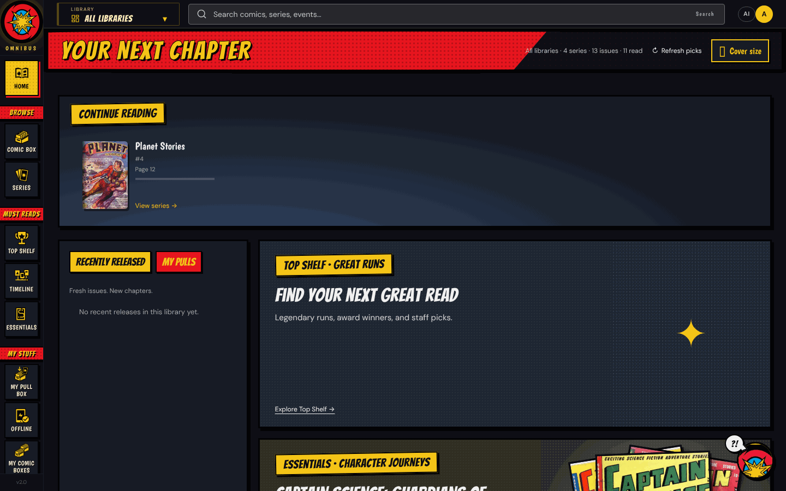
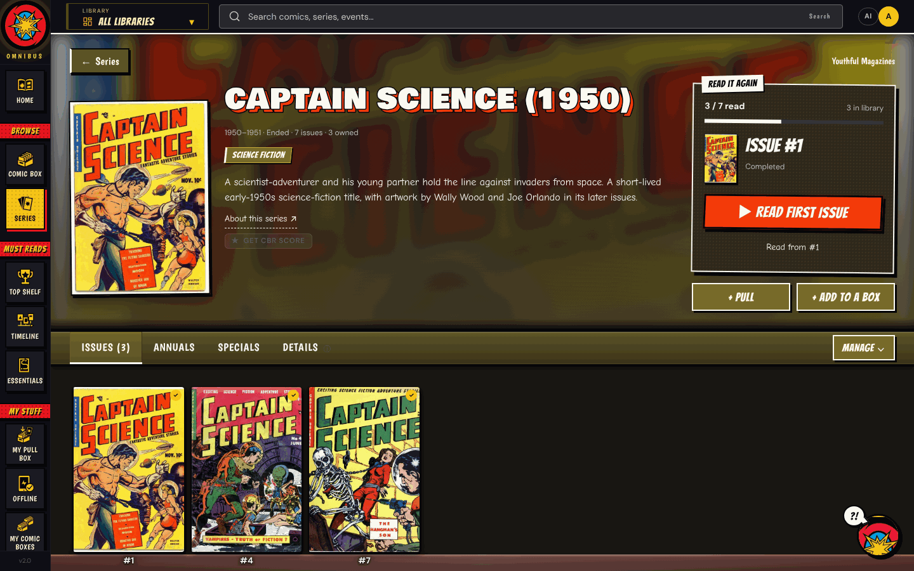
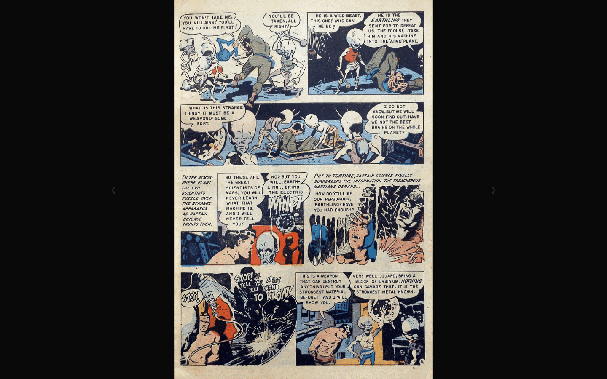
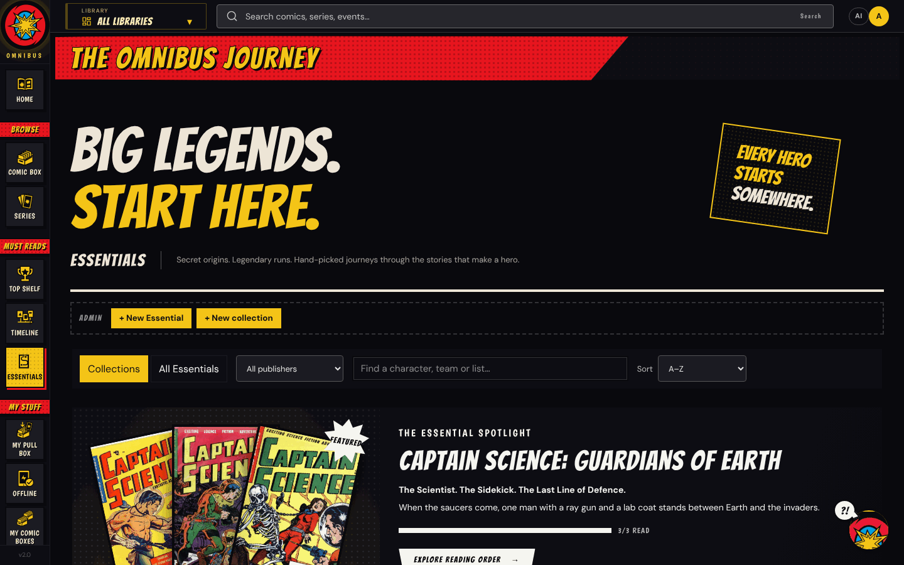
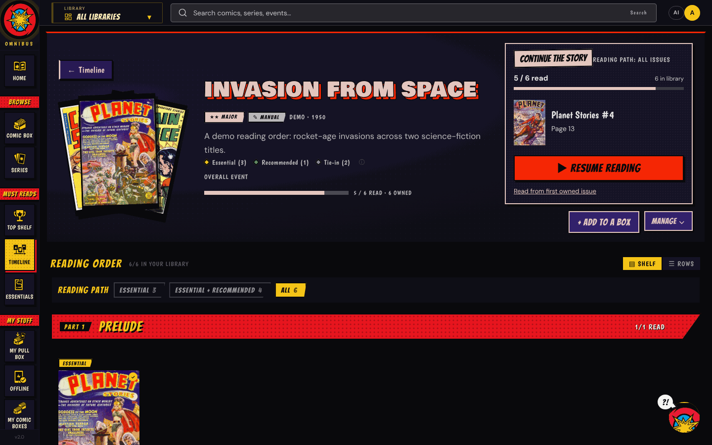
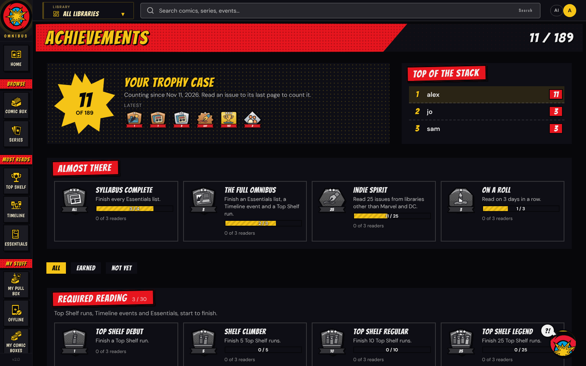
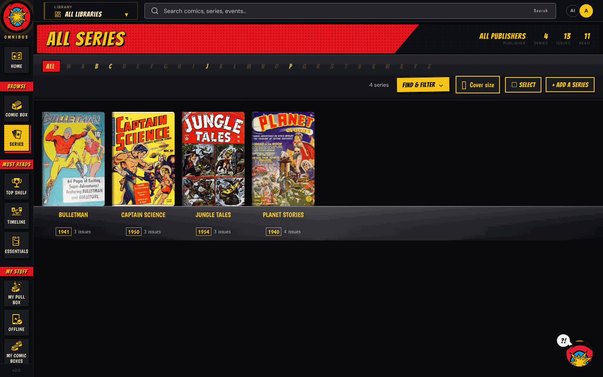

# Omnibus

**A self-hosted comic library for you and your household.** Omnibus scans your CBZ/CBR collection, matches it to Comic Vine, and gives everyone a fast reader, reading orders worth following, and a shop clerk with opinions. It runs as one Docker container.



---

## What it does

**Read**
- A built-in reader for CBZ, CBR, CB7 and CBT, with swipe and keyboard navigation, right-to-left manga, and progress that follows you between devices.
- Installs as an app on phones and tablets, with offline downloads for reading away from home.

**Find what to read next**
- **Essentials:** hand-picked character journeys (where to start with Batman, Wonder Woman and so on), grouped into shelves by collection.
- **Top Shelf:** acclaimed, award-winning and screen-adapted runs, with Eisner and Harvey award data.
- **Timeline:** crossover events in reading order, each issue marked Essential, Recommended, Tie-in or Aftermath.
- **Reading lists and comic boxes:** build your own, share them, and follow other readers' lists.
- Every list knows what you own, what you've read and what's missing, and can request or fetch the gaps.

**Keep the collection healthy**
- Library scanning with Comic Vine matching, ComicInfo tagging, series descriptions and genres.
- Monitored series, weekly releases and a personal **Pull Box** for new issues.
- Optional downloads through Prowlarr, SABnzbd, qBittorrent and direct links, with post-processing into your folders.
- Requests and problem reports from readers, duplicate and damaged-file checks, and missing-annual detection.

**Comic Book Guy** (optional, needs an AI key)
- An in-app assistant with an opinion on everything. He answers continuity questions, recommends what you own, builds reading lists, and writes spoiler-aware "Previously on…" recaps up to the issue you're on.
- AI also drafts Timeline events and Top Shelf runs for an admin to review. Every AI feature is optional, and admins see the cost of each request.

**For the household**
- Separate accounts with their own progress, lists and Pull Box; admin and reader roles; optional single sign-on (OIDC).
- Achievements with a household leaderboard, including hidden ones to stumble into.
- App themes, character colour palettes on reading pages, and nightly database backups with in-app restore.

## Screenshots

Shown with public-domain comics from the 1940s and 1950s (Bulletman, Captain Science, Jungle Tales, Planet Stories).

| | |
|---|---|
|  |  |
|  |  |
|  |  |

---

## Before you install

- **It's a hobby project, and it was vibe coded.** One person built Omnibus for their own household, mostly by working with AI coding assistants, and it was a lot of fun to make. It has over 1,000 automated tests, but it has mainly run on one install (Windows with Docker Desktop, a library of about 2,300 series). Expect rough edges, and please report what you find.
- **The AI is optional, and you pay for what you use.** Reading, the library, lists, Essentials, Top Shelf, the Timeline and downloads all work without it. Comic Book Guy, recaps and the generators call Anthropic, OpenAI or Google Gemini with your own API key, billed by them. Most questions cost a fraction of a cent; admins see the cost of every request.
- **Back up your comics first.** Omnibus can write metadata into your archives and file downloads into your folders. Try it on a copy of your library before pointing it at the real one.
- **Comic Vine is slow on purpose.** Matching uses the free Comic Vine API, which limits how often you can ask. The first pass over a large library can take hours, and Omnibus paces itself to stay within the limit.
- **It comes with no comics.** The download features only connect to services you set up yourself. What you download is your responsibility; follow the law where you live.
- **Keep it private, or put it behind HTTPS.** No one has done a security audit. Change the admin password, use a reverse proxy with HTTPS if it's reachable from outside your home, and keep `JWT_SECRET` and `OMNIBUS_SECRET` private.
- **Support is best effort.** Issues and suggestions are welcome. It's MIT-licensed and comes with no warranty.

## Quick start

You need Docker with Docker Compose, and a folder of comics. Back up your comics first: Omnibus can write metadata into archives and file new downloads into your folders.

**1. Get the files**

```bash
mkdir omnibus && cd omnibus
curl -o docker-compose.yml https://raw.githubusercontent.com/CredibleBulk52/Omnibus/main/docker-compose.prod.yml
curl -o .env https://raw.githubusercontent.com/CredibleBulk52/Omnibus/main/.env.example
```

**2. Edit `.env`.** At minimum:

| Setting | What to put |
|---|---|
| `COMICS_HOST_PATH` | Your comics folder, for example `D:/Comics` or `/mnt/comics` |
| `DOWNLOADS_HOST_PATH` | A folder for downloads (it can stay empty if you never download) |
| `JWT_SECRET` | A random string: `openssl rand -hex 32`. The example value is refused. |
| `OMNIBUS_SECRET` | Another random string. It encrypts API keys saved in the app; keep a copy. |

**3. Start it**

```bash
docker network create omnibus-net   # once
docker compose up -d
```

**4. First run.** Open `http://localhost:9810` and sign in as `admin` / `admin`.
1. Change the password in **Settings › People**. Home reminds you until you do.
2. Go to **Library › Libraries & scanning › + Add Library**, point it at a folder under `/comics` (for example `/comics` or `/comics/DC Comics`), and choose **Add & Scan**.
3. Optional: add a Comic Vine key in **Settings › Connections** for metadata, and an AI key in **Settings › AI & Comic Book Guy** for the assistant and generators.

Essentials, Top Shelf and the Timeline start empty. Admins fill them with the **+ New** button on each page, by hand or drafted by AI and then reviewed.

**Building from source** instead of using the published image:

```bash
git clone https://github.com/CredibleBulk52/Omnibus.git
cd Omnibus
cp .env.example .env    # then edit it as above
docker network create omnibus-net
docker compose up -d --build
```

On Windows, `.\deploy.ps1` builds and deploys with a health check and automatic rollback. See [Backups and recovery](docs/BACKUP.md).

---

## Keys and services

| Service | Needed? | What it adds |
|---|---|---|
| [Comic Vine](https://comicvine.gamespot.com/api/) API key | Recommended (free) | Matching, issue lists, covers for missing issues, series details |
| Anthropic, OpenAI or Google Gemini key | Optional | Comic Book Guy, recaps, AI-drafted events and runs, descriptions, genre tagging. See [AI models](docs/AI_MODELS.md). |
| Metron token | Optional | A second opinion on whether a series has ended |
| Prowlarr, SABnzbd, qBittorrent | Optional | Searching for and downloading issues |
| OIDC provider (Authentik, Keycloak and others) | Optional | Single sign-on alongside local accounts |

Keys can go in `.env` or be saved in **Settings** after first launch (encrypted with `OMNIBUS_SECRET`).

<details>
<summary>All <code>.env</code> settings</summary>

| Variable | Required | Description |
|---|---|---|
| `JWT_SECRET` | Yes | Random secret of at least 32 characters. Changing it signs everyone out. |
| `OMNIBUS_SECRET` | Recommended | Encrypts API keys stored in the database. A backup restored elsewhere needs the same value. |
| `COMICS_HOST_PATH` | Yes | Host folder mounted at `/comics`. |
| `DOWNLOADS_HOST_PATH` | Yes for the production Compose file | Host folder mounted at `/downloads`. |
| `CV_API_KEY` | Recommended | Comic Vine API key. |
| `ANTHROPIC_API_KEY`, `OPENAI_API_KEY`, `GEMINI_API_KEY` | Optional | AI provider keys. |
| `PROWLARR_URL`, `PROWLARR_API_KEY` | Optional | Prowlarr indexer search. |
| `SABNZBD_URL`, `SABNZBD_API_KEY` | Optional | SABnzbd for NZB downloads. |
| `OIDC_BASE_URL`, `OIDC_CLIENT_ID`, `OIDC_CLIENT_SECRET` | Optional | Single sign-on. |
| `OMNIBUS_URL` | With SSO | Public URL of your install, for the SSO redirect. |
| `DB_BACKUP_HOST_PATH`, `DB_BACKUP_KEEP` | Optional | Where nightly database backups go and how many to keep (default `./_backups/db`, 14). |
| `BACKUP_COPY_HOST_PATH` | Optional | A second backup folder on another drive or a NAS. |
| `LOG_HOST_PATH`, `LOG_KEEP_DAYS` | Optional | Daily log files (default `./logs`, 14 days). |
| `PORT` | Optional | Default `9810`. |

</details>

### Single sign-on

Set `OIDC_BASE_URL`, `OIDC_CLIENT_ID`, `OIDC_CLIENT_SECRET` and `OMNIBUS_URL`, restart, and register `https://your-omnibus-url/api/auth/callback` with your provider. Omnibus uses fixed paths under the base URL (`/authorize/`, `/token/`, `/userinfo/`) rather than discovery; an Authentik base URL looks like `https://auth.yourdomain.com/application/o`. Local sign-in stays available, and new SSO accounts get the user role.

### Behind a reverse proxy (Caddy)

```caddy
omnibus.yourdomain.com {
    encode gzip
    reverse_proxy localhost:9810
}
```

---

## FAQ

**Do I need an AI key?** No. Reading, the library, lists, Essentials, Top Shelf, the Timeline and downloads all work without one. AI adds Comic Book Guy, recaps and the generators. Costs depend on the provider and model; a typical question costs a fraction of a cent.

**Does Omnibus come with comics?** No. It organises and reads comics you already have. It ships no comics, cover art or publisher logos; admins can upload their own logos and character art for shelves and themes.

**Where is my data?** Comics stay in your folder. Everything else (accounts, progress, lists, settings) is one SQLite database in the `omnibus-data` Docker volume, backed up every night. See [Backups and recovery](docs/BACKUP.md).

**Can I read on my phone?** Yes. Open the site and add it to your home screen, and download issues for offline reading.

**What file formats work?** CBZ, CBR, CB7 and CBT. A `.cbr` that is really a ZIP is detected and read anyway.

**Is it safe to put on the internet?** Change the admin password first, serve it over HTTPS through a reverse proxy, and keep `JWT_SECRET` and `OMNIBUS_SECRET` private.

---

## Documentation

- [Documentation index](docs/README.md)
- [Backups and recovery](docs/BACKUP.md): backups, restore, deploys, logs and health checks
- [AI models](docs/AI_MODELS.md): which tasks use AI, supported providers and recommended models
- [Development and checks](docs/DEVELOPMENT.md): running the tests and building
- [Metadata service](backend/metadata/README.md): how matching and tagging protect your files

## License

Omnibus is released under the [MIT License](LICENSE). Dependencies keep their own licenses ([THIRD_PARTY_NOTICES.md](THIRD_PARTY_NOTICES.md)). Omnibus is a fan project and is not affiliated with Comic Vine, any publisher or any AI provider. Character and publisher names belong to their owners; the license grants no rights to third-party comics, artwork or trademarks.
